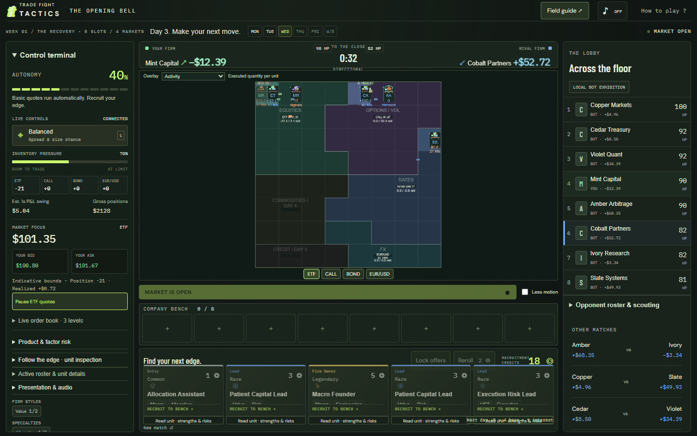
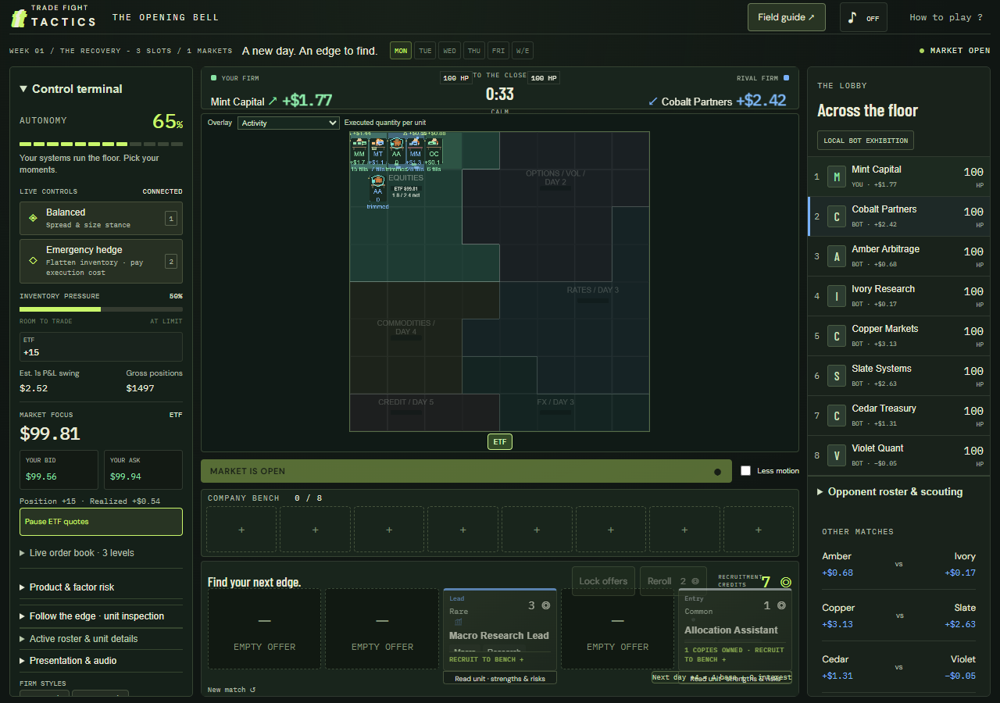
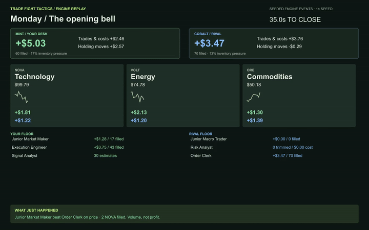
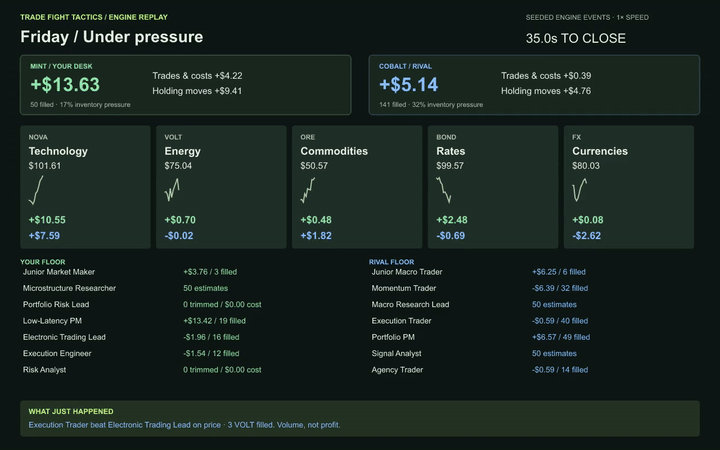

# Trade Fight Tactics

**Build a trading firm. Find your edge. Survive the closing bell.**

A market-making autobattler where the market is the battlefield. Recruit traders, researchers and risk specialists, combine their traits, then watch your desk compete for the same orders as a rival. Your build decides which controls you get: let the algorithms work, intervene at the right moment, or assemble a hybrid.

Forty seconds. One shared market. Your quotes, your inventory, your consequences.

Deploy onto one shared **8 x 8 trading floor**, a patchwork of Equities / ETFs, Options / Vol, Rates, Commodities, FX and Credit. Units trade the product at their tile. Rival firms materialize in the same regions, in separate ownership slots. No role quotas; support-only and concentrated firms remain legal.

[](docs/media/browser-battle.webm)

Controls and actual unit accounting sit on the left; standings and scouting on the right. The square board, eight-slot bench and five-offer shop fit together at 1920x1080, 1440x900 and 1366x768. [Market architecture and financial limits](docs/regional-market-architecture.md), [UX and verification](docs/regional-ux-and-validation.md).

> Local mechanics prototype. Trade Fight Tactics is the internal working title; the public-release name will change. This is a finance-inspired strategy game, not a calibrated trading simulator.

## Watch a trading day

[](docs/media/browser-battle.webm)

**[Watch the actual browser battle (WebM)](docs/media/browser-battle.webm)** — a real 40-second game session captured in headless Edge, including preparation and the closing bell. No accelerated simulation clock. Kenney CC0 characters and original workstations render through PixiJS v8. [Art and dependency licenses](docs/assets-and-licenses.md).

The clips below are separately labeled **offline engine visualizations**:

[](https://github.com/Richard-Y-W/Trade-Fight-Tactics/blob/main/docs/media/opening-bell.mp4)

**[Watch Monday's opening bell (MP4)](https://github.com/Richard-Y-W/Trade-Fight-Tactics/raw/refs/heads/main/docs/media/opening-bell.mp4)** - three units per firm, three markets, different approaches to execution and information.

[](https://github.com/Richard-Y-W/Trade-Fight-Tactics/blob/main/docs/media/friday-stress.mp4)

**[Watch Friday's stress session (MP4)](https://github.com/Richard-Y-W/Trade-Fight-Tactics/raw/refs/heads/main/docs/media/friday-stress.mp4)** - seven units per firm, five markets, competing order streams and costly protection.

These are **offline engine replay visualizations, not recordings of the application UI**. Every price, fill, position and score comes from the actual seeded simulation. Both sides use autopilot. Clips show the complete 40-second day plus a closing hold; GIFs are short excerpts. [Replay manifest and exact configurations](docs/media/manifest.json). Regenerate them with `npm run showcase` after installing development dependencies.

## Play locally

Requires **Node.js 22+**. Playing needs no package installation.

```sh
npm run dev
```

Open **http://127.0.0.1:5173**. Recruit with your starting 10 credits, deploy onto the floor, then **Ring the bell**. Select a market to inspect quotes. Your units unlock controls such as Press, directional tilt and emergency hedging. Sound starts off.

## A desk that grows with the week

| | Monday | Tuesday | Wednesday | Thursday | Friday |
| --- | --- | --- | --- | --- | --- |
| Deployed units | 3 | 4 | 5 | 6 | 7 |
| Open markets | 1 | 2 | 4 | 5 | 6 |
| Session | Calm | Calm | Directional | Calm | Unstable |

Equities opens Monday; Options Tuesday; Rates and FX Wednesday; Commodities Thursday; Credit Friday. Locked regions remain visible. Region area creates deployment room, never extra profits.

The shop's rarity odds advance each day. Save credits for capped interest, reroll for missing pieces, or merge three matching copies into a stronger star. Weekend breaks offer a call, put or cash-preserving skip. Longer matches, era progression and resource-funded floor leveling are future goals.

- **Draft an operation:** 32 unit identities, seven firm styles, six specialties, five career tiers and a shared finite recruitment pool used by all eight local firms.
- **Choose your workload:** autonomous quoting, research support, active execution, inventory protection and hybrids. Controls come from the units you deploy.
- **Compete for actual orders:** persistent price/time-priority books, finite depth, partial fills, IOC orders and unit-owned quote streams.
- **Read the fight:** green and blue identify the firms; actual order contests connect opposing units. Select a floor unit to see its results and active trait partners.
- **Understand the score:** Follow the edge separates trading and execution costs from gains or losses on held inventory. Researchers show estimates; protectors show exposure trimmed and cost paid.
- **Scout and adapt:** rival floor and bench in the right sidebar, local standings and three background duels, searchable unit/trait field guide and hover explanations.

## Is it skill or luck?

Both. Seeded market moves and customer flow create uncertainty, while quoting, FIFO position, information quality, inventory and fees determine cash flows. The score is net marked-to-market P&L after costs, not a random combat roll. Winning more fills does not guarantee winning money.

The regional model goes beyond a rename: equity spot, a marked European call with expiry and a contract multiplier, duration-sensitive rates, pip-quoted EUR/USD contracts, commodity supply shocks and spread/default-sensitive credit have distinct price processes and shared books. Contract-aware cash, position basis, fees, unit attribution and regional totals are tested. Research is noisy, imperfect and market-specific; routing and finite support change actual order arrival.

This is a coherent simplified game model, not an institutional simulator. No margin, borrow, financing, calibrated market impact, full option chain, ETF basket or FX conversion portfolio exists. Automated hedging trims covered inventory at a cost; it is not a full delta-hedging system. Options/credit tail losses remain a balance concern. A separate 360-duel drafted-bot audit finds only 12.5% profitable Friday results; the stress day is still too punishing.

The **576-duel regional audit** checks reconciliation throughout paired-seat scenarios. Calm HFT averaged +$16.36; the unequal-cost diversified reference averaged -$223.84 in directional sessions. These are diagnostics, not balanced-composition comparisons or proof of fun. Headless step mean was about **0.107ms**, excluding rendering. The real-time browser recording has separate frame-interval measurements; no FPS guarantee. Historical proxy audits and MP4 showcases remain available, clearly separate from this model.

## Develop and verify

```sh
npm ci
npm test
npm run check
npm run check:readout
npm run check:overhaul
npm run check:battlefield
npm run build:renderer
npx playwright install ffmpeg
npm run test:e2e
npm run audit:bots        # historical five-proxy model
npm run audit:compositions # historical five-proxy model
npm run audit:battlefield # historical proxy/formation audit
npm run audit:regional   # current six-product model
npm run benchmark:market
npm run showcase
```

The browser game uses plain JavaScript, HTML/CSS menus, PixiJS v8 combat and accessible SVG/CSS fallback scenes. The committed renderer bundle supports local play without installation; rebuild it after changing canvas code. Headless simulation remains DOM-free. Happy DOM supplies logic/UI tests; Playwright uses an installed Microsoft Edge for browser checks and screenshots. The offline showcase generator uses resvg and FFmpeg. No C++ requirement has been established.

| Area | Entry point |
| --- | --- |
| Market, accounting and risk | [engine.js](src/engine.js), [market-session.js](src/market-session.js), [orderbook.js](src/orderbook.js) |
| Units, traits and recruitment | [roster.js](src/roster.js), [company.js](src/company.js) |
| Regional map and real products | [markets.js](src/markets.js) |
| Bot firms and daily progression | [league.js](src/league.js), [progression.js](src/progression.js) |
| UI and battle explanations | [app.js](src/app.js), [battle-readout.js](src/battle-readout.js) |
| Reproducible showcases | [showcases.mjs](scripts/showcases.mjs) |

79 automated Node tests cover accounting, supply conservation, queues, upgrades, daily unlocks, controls, attribution, option expiry, information boundaries, covariance, placement, latency, local support and a full-week UI journey. Six browser checks cover actual dragging/swaps/bench return, regional geometry, scouting, opening continuity, market selection, Pixi, a full week/weekend, inspection, resizing, reduced effects, missing-character fallback and real-time video/frame measurements. Screenshots and audit artifacts live under `docs/media/` and `docs/audits/`. Human beginner comprehension remains untested; the [readability protocol](docs/visual-readability-tests.md) is a release gate.

## What's next

Make every trading day readable enough that a spectator can identify the carry, the risk and the support without studying a dashboard. Then improve information asymmetry, differentiate strategy families and run controlled composition playtests. Items come after the combat is understandable.

Online multiplayer, an authoritative server, live spectating, persistent saves, item crafting, opening PvE and historical-era unlocks are **not implemented**. The current lobby is a local bot exhibition, and the main rival does not rotate. Trading bankroll and asset holdings reset daily; recruitment credits, units, tile formations and health persist within the match.

## Keep the context

- [Start here: project handoff](CONTEXT.md)
- [Full game vision and discussion record](docs/GAME-VISION.md)
- [Current fast-beta pacing and audit](docs/FAST-BETA-PACING.md)
- [Order books and combat roles](docs/ORDERBOOK-AND-COMBAT.md)
- [Watchability and simulation assessment](docs/WATCHABILITY-AND-SIMULATION.md)
- [Combat overhaul assessment and priorities](docs/combat-overhaul-plan.md)
- [Unit behavior matrix](docs/unit-behavior-matrix.md)
- [Current financial model](docs/financial-model.md)
- [Visual design system](docs/visual-design-system.md)
- [Assets and licenses](docs/assets-and-licenses.md)
- [Implementation results and remaining work](docs/implementation-results.md)
- [Trait research and unit design](docs/TRAIT-RESEARCH.md)
- [Economy, interest and rivalry](docs/ECONOMY-AND-RIVALRY.md)
- [Visual learning principles](docs/VISUAL-LEARNING.md)

Earlier [market-math](docs/MARKET-MATH.md), [0.1](docs/PROTOTYPE.md) and [0.2](docs/PROTOTYPE-V0.2.md) documents remain as historical design records. Current implementation notes take precedence where they differ.

Current instrument IDs, legacy aliases, exact region map, unlocks, event semantics, test artifacts and remaining work: [regional architecture](docs/regional-market-architecture.md) and [implementation results](docs/implementation-results.md).
